# Sim-to-Real Robot Grasping with a Time-of-Flight Camera

A real robot arm, its Gazebo digital twin, and a controlled experiment to find out what
actually limits sim-to-real transfer.


[](LICENSE)

<table>
  <tr>
    <td width="50%">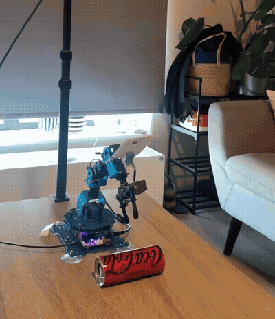</td>
    <td width="50%">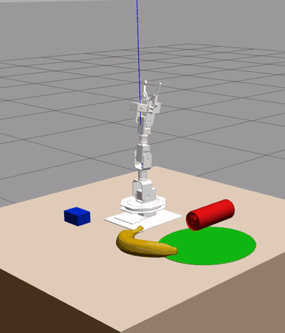</td>
  </tr>
  <tr>
    <td align="center"><sub><b>Real xArm 1S.</b> Hover and correct aim (sped up ×4), close, lift, carry.</sub></td>
    <td align="center"><sub><b>Gazebo digital twin.</b> The same task in simulation (sped up ×3.6).</sub></td>
  </tr>
</table>

**Bachelor's thesis in Artificial Intelligence, University of Groningen, 2026. Final grade
8/10.** Self-proposed topic, supervised by Dr. Hamidreza Kasaei (IRL Lab).
By Marcell Mór Szőkedencsi · [LinkedIn](https://www.linkedin.com/in/marcell-szokedencsi) · [GitHub](https://github.com/Marci0309)

When a vision-based robot works in simulation and fails on hardware, depth noise is one of
the first suspects, because simulators don't reproduce it. I built a complete system to
test that directly. I measured a real time-of-flight (ToF) camera, modelled its noise,
injected the model into simulation, scaled it up until perception broke, and validated the
outcome on a physical arm over 60 grasp trials.

**The finding:** at indoor noise levels, depth-noise fidelity does not limit this system.
Accuracy holds up to about ×10 the measured noise, a level typical of harsh or outdoor ToF
use. On the real arm the largest error was the kinematic model, which a closed-loop visual
servo removes within its working range. After that, grip mechanics decide what gets picked up.

[The experiment](#the-experiment) · [Computer vision](#computer-vision) ·
[Robotics](#robotics) · [Results](#results) ·
[Problems I solved](#problems-i-hit-and-how-i-solved-them) ·
[Next: chess](#whats-next-teaching-it-to-play-chess) · [Try it](#try-it)

## Highlights

| Number | What it means |
|---|---|
| **60 + 480** | Trials: 60 physical grasps on the real arm and 480 simulated feasibility checks, with seeded conditions and confidence intervals |
| **0.55–0.87 mm** | Measured depth noise from 0.4 to 0.8 m. It stays flat with range, so the Kinect-era quadratic model does not fit this sensor |
| **53–99%** | Share of pixels around each object's edge that are flying pixels. The error that matters sits at edges, not on surfaces |
| **< 0.1 mm** | Average change in planar pose error when the measured noise is injected (0.38 mm for the most affected object) |
| **×10** | How far noise can be scaled before pose accuracy starts to slip. Grasping collapses at ×20 |
| **−1.4 to +3.6 mm** | Real-versus-simulated planar pose gap across four objects |
| **22.5 → 1.9 mm** | Median aim error with closed-loop visual servoing, in the trials where it converged |
| **18 / 18** | Box and can lifts when the servo converged. Across all objects and trials: 34/60 (57%), [explained below](#60-real-grasps) |

## What I built

<table>
  <tr><th width="50%">Computer vision</th><th width="50%">Robotics</th></tr>
  <tr>
    <td valign="top">
      <ul>
        <li>ToF sensor characterisation from raw 200-frame depth stacks</li>
        <li>A four-term depth-noise model running as a ROS 2 node</li>
        <li>Depth segmentation: table removal, connected components, per-axis median centroid</li>
        <li>ChArUco camera calibration with <code>solvePnP</code>, composed across the RGB and ToF sensors</li>
        <li>ArUco tracking of the gripper in the table frame</li>
        <li>Pose evaluation against Gazebo ground truth and real fiducials</li>
      </ul>
    </td>
    <td valign="top">
      <ul>
        <li>A ROS 2 Humble and Gazebo Classic digital twin with <code>ros2_control</code></li>
        <li>Closed-form inverse kinematics for a 5-DOF arm in pure NumPy</li>
        <li>A closed-loop visual servo that cancels a 28% kinematic error</li>
        <li>A ROS-free USB-HID bridge and per-servo calibration for the real arm</li>
        <li>A C++ Gazebo plugin for contact-triggered grasping</li>
        <li>Windows and WSL2 integration, with a hardware-free <code>--dry-run</code> for the real-arm pipeline</li>
      </ul>
    </td>
  </tr>
</table>

## The experiment

**Research question:** how does modelling realistic ToF sensor noise affect the sim-to-real
gap in RGB-D tabletop pose estimation and manipulation? My starting hypothesis was that
injecting measured noise would shrink the gap. At realistic noise levels, it does not.

| Phase | Where | Question | Scale |
|---|---|---|---|
| 1 | Simulation | Can a digital twin match the bench? | URDF, tabletop scene, overhead RGB-D camera |
| 2 | Real camera | How noisy is the sensor? | 200-frame stacks of a flat target at 5 distances and of each object |
| 3 | Simulation | Does noise degrade pose? | 7 noise conditions, about 430 frames each |
| 4A | Simulation | Does noise degrade grasping? | 6 conditions × 4 objects × 20 placements = 480 trials |
| 4B | Real bench | How accurate is pose on real data? | 5 scenes with fiducial ground truth |
| 4C | Real bench | Does the arm actually lift things? | 4 objects × 5 placements × 3 repeats = 60 trials |

<table>
  <tr>
    <td width="36%" rowspan="2">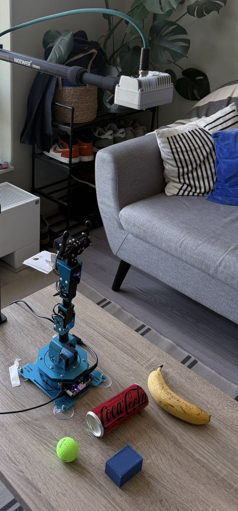</td>
    <td>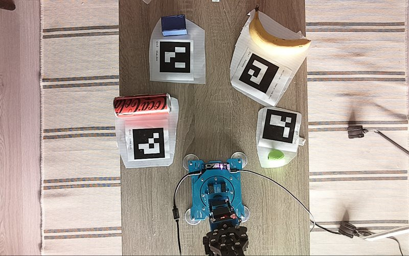</td>
  </tr>
  <tr>
    <td valign="top"><sub><b>Left:</b> the bench, with a Luxonis OAK-D SR PoE on a boom 0.68 m above the table and a low-cost Hiwonder xArm 1S (5-DOF plus a 55 mm parallel-jaw gripper). <b>Above:</b> what the camera sees. The ArUco markers give each object a ground-truth position for Phase 4B and are removed for real grasps.</sub></td>
  </tr>
</table>

All depth sources feed the same perception method and the same kinematics, so depth noise is
the only variable separating the simulated conditions.

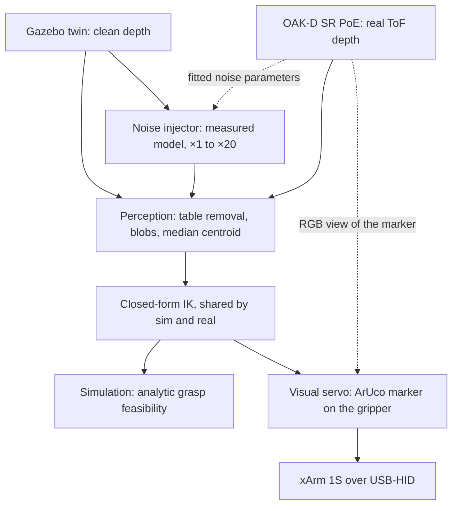

## Computer vision

### Characterising the sensor

ToF error depends on range, surface and scene geometry, so I measured it with on-camera
smoothing turned off, using [200-frame stacks](tof_perception/scripts/capture_tof_calibration.py)
of a flat target at five distances and of each object at table distance.

- **Surfaces are quiet.** Axial noise is 0.55 to 0.87 mm from 0.4 to 0.8 m and does not grow
  with range. Fitting the quadratic model used for Kinect-class sensors
  (Nguyen et al., 2012) gives a slightly negative curvature, so it does not describe this
  multi-frequency sensor. Object surfaces read 0.62 to 0.71 mm, and bias stays within ±3 mm.
- **Edges are not.** In a 6-pixel ring around each object, 53 to 99% of pixels report a depth
  strictly between the object and the table. Even a sharp box wall reads as a slope about 6
  to 7 pixels wide.

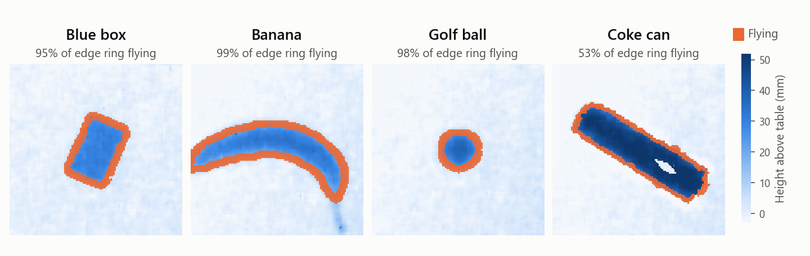

<sub>Real ToF data, mean of 200 frames. The white hole on the can is a spot on its shiny
surface that never returned a valid depth.</sub>

### Modelling and injecting the noise

[`depth_noise_injector`](noise_injection/noise_injection/depth_noise_injector.py) is a ROS 2
node that sits between Gazebo's clean depth stream and perception. It applies four terms:
axial Gaussian noise, lateral pixel jitter, mixed pixels at depth edges, and random dropout.
Two seeded random streams keep the Gaussian draws independent of the discrete masks, so toggling
one term does not reshuffle the others, and perception switches stream through one launch argument
with no code change.

| Parameter | Kinect defaults (Nguyen et al., 2012) | Measured OAK-D |
|---|---|---|
| Axial noise $\sigma_z(z)=a+b(z-z_0)^2$ | $a$ = 1.2 mm, $b$ = 1.9 mm/m², $z_0$ = 0.4 m | $a$ = 0.9 mm, $b$ = 0 |
| Edge gradient threshold | 5 cm | 2 cm |
| Edge pixel probability | 0.30 | 0.70 |
| Dropout probability | 0.02 | 0 |
| Lateral jitter | 0.8 px | 0.8 px (literature value, not measured) |

The sweep then multiplies the axial term by 1, 2, 5, 10 and 20.

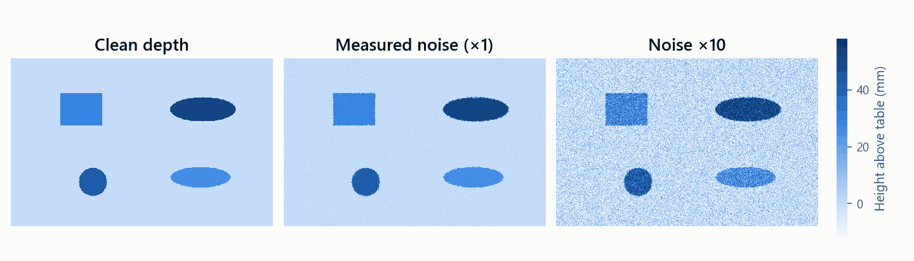

<sub>A synthetic test frame through the same four terms. At the measured level the change is
hard to see at all.</sub>

### Perception

The pipeline in [`pose_estimator.py`](tof_perception/tof_perception/pose_estimator.py) is
classical on purpose, so that every error can be traced to calibration or depth noise and
not to a learned model.

1. **Remove the table.** Its plane is the median of all valid depths. Anything at least 5 mm
   closer to the camera counts as object.
2. **Find objects.** Connected components give one blob per object.
3. **Name them.** HSV colour labels each blob and never contributes to geometry.
4. **Locate them.** Blob pixels are back-projected through the pinhole model and reduced to a
   per-axis median. Its 50% breakdown point is why the flying-pixel ring barely moves the estimate.

The output is a translation-only (3-DoF) pose. On the bench,
[`perceive_scene_4c.py`](tof_perception/scripts/perceive_scene_4c.py) applies the same method
with one object in view at a time, plus a height band above the calibrated table and a mask
around the arm base, so the arm itself is never segmented. It also estimates a PCA jaw axis, but the
formal trials use each object's predefined grasp angle so that real and simulated grasps match.

<table>
  <tr>
    <td width="33%">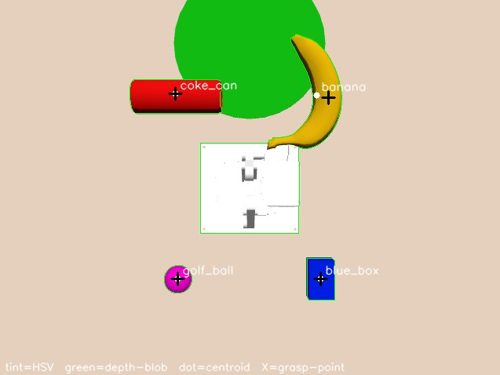</td>
    <td width="33%">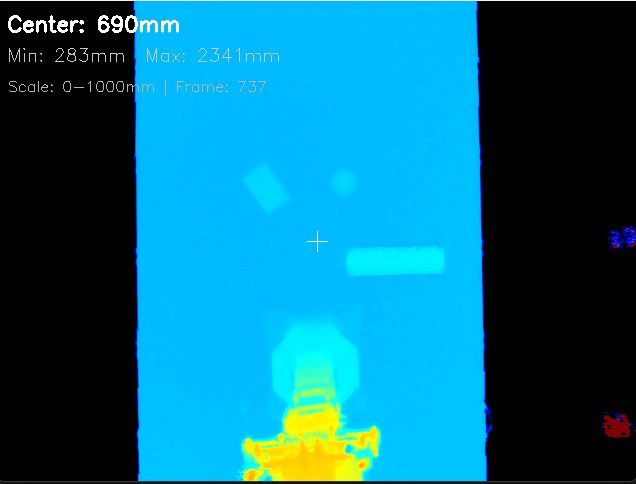</td>
    <td width="33%">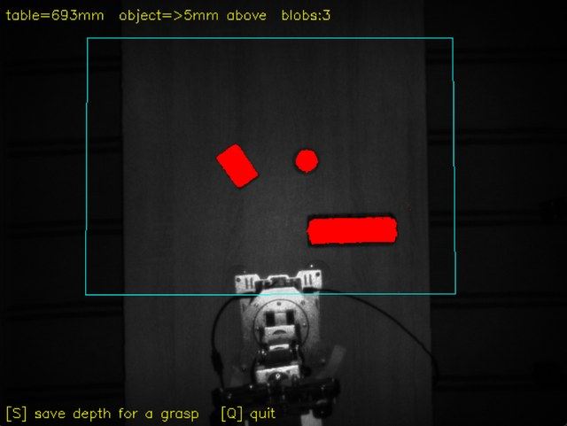</td>
  </tr>
  <tr>
    <td align="center"><sub>Simulation: depth blob, label, centroid, grasp point</sub></td>
    <td align="center"><sub>Real ToF depth</sub></td>
    <td align="center"><sub>Real segmentation, table plane at 693 mm</sub></td>
  </tr>
</table>

### Calibration

A pixel passes through a chain of calibrated frames on its way to a servo command:

```text
depth pixel ── pinhole intrinsics ──────────────────► ToF frame
            ── factory extrinsic + ChArUco solvePnP ► table frame
            ── similarity fit (scale 0.777) ────────► arm frame
            ── closed-form IK ──────────────────────► joint angles
            ── per-servo calibration ───────────────► servo commands
```

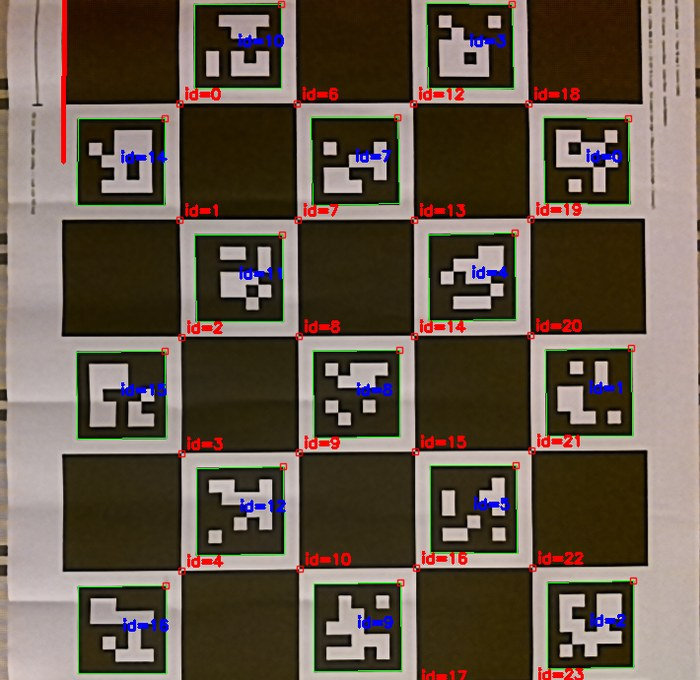

The ToF amplitude image is too soft to decode ChArUco markers, so
[`solve_table_extrinsics.py`](tof_perception/scripts/solve_table_extrinsics.py) detects the
board on the RGB sensor and composes the pose into the depth frame through the camera's factory
extrinsic. Two independent checks guard the result. The
[calibration in this repo](tof_perception/board_4b/table_extrinsics.json) uses 22 of 24 corners
at 0.33 px reprojection error, and its camera height (683.9 mm) agrees with a separate plane
fit to the depth image (685.7 mm) to within 1.8 mm.

<br clear="right"/>

## Robotics

### Digital twin

The Gazebo Classic 11 and ROS 2 Humble scene mirrors the bench, with a URDF model of the arm, the
same camera height and the same four objects. `ros2_control` runs a joint-trajectory controller
for the arm and an effort controller for the gripper.

Gazebo Classic cannot reliably resolve contact on small, curved objects, because fingers pass
through them. So I kept two things separate:

- **The reported metric is analytic.** `grasp_feasible` is true when the perceived centre lies
  within `(55 mm − object width) / 2` of the true centre, meaning the open jaws would straddle
  the object. The name is deliberate: this is not a pick-success rate.
- **The on-screen grasp is physical.** My C++ world plugin,
  [`link_attacher.cpp`](xarm1s_grasp_plugin/src/link_attacher.cpp), welds the object to the
  gripper only after both fingers hold sustained contact. It is for visualisation and feeds no
  reported number. A logged 1 s fallback keeps demos from stalling.

### Closed-form inverse kinematics

The arm is a base yaw, a planar three-link chain and a wrist roll. Because the three pitch axes
are parallel, [`arm_ik.py`](xarm1s_manipulation/xarm1s_manipulation/arm_ik.py) solves position
in closed form, which removes solver convergence as a source of error. A search finds the
steepest approach reachable within joint limits, and waypoints are seeded so the arm stays in
one branch instead of flipping mid-carry.

`arm_ik.py` and [`grasp_common.py`](xarm1s_manipulation/xarm1s_manipulation/grasp_common.py)
import no ROS, so the Gazebo node and the real-arm executor share one solver and one set of
grasp data.

### Driving the real arm

The arm is a USB-HID device and the camera sits on a PoE link, neither of which is cleanly
reachable from WSL. So [`real_grasp_executor.py`](xarm1s_manipulation/scripts/real_grasp_executor.py)
and [`real_arm_driver.py`](xarm1s_manipulation/xarm1s_manipulation/real_arm_driver.py) run on
Windows as a lightweight, ROS-free bridge, and call into WSL for perception at each servo step.

### Closed-loop visual servo

The real arm reaches about 28% farther than its URDF predicts. A global scale of 0.777 fixes
most of that, but leaves about 14 mm RMS of position-dependent error. That is more than the blue
box's ±7.5 mm jaw tolerance, so open-loop grasping only worked in a patch about 4 cm wide, and
six touch points cannot identify a better kinematic model. So I closed the loop.

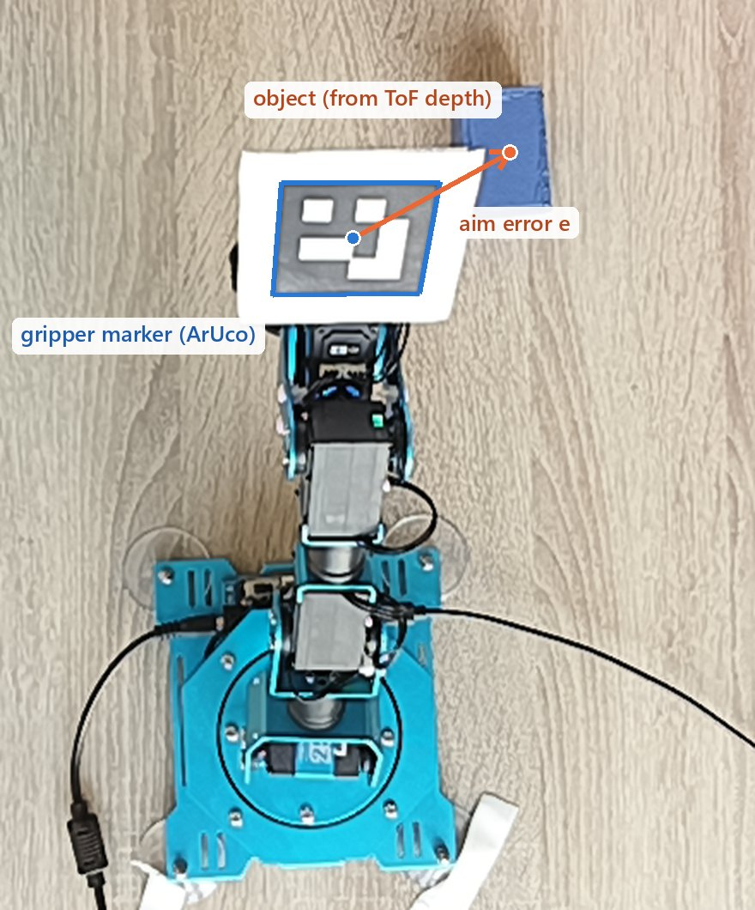

Before descending, the arm hovers and the overhead camera measures both the gripper's ArUco
marker and the object's perceived position in the same table frame.
[`visual_servo.py`](xarm1s_manipulation/xarm1s_manipulation/visual_servo.py) then iterates:

```math
\mathbf{e} = \mathbf{p}_{\text{obj}} - (\mathbf{p}_{\text{marker}} + \mathbf{t}_{\text{tip}}),
\qquad \text{target} \leftarrow \text{target} + K\mathbf{e}
```

with $K = 0.6$ until $\lVert\mathbf{e}\rVert < 3$ mm. Because $\mathbf{e}$ is a difference between
two points measured through the same camera in the same frame, the wrong kinematics and the scale
cancel as common-mode bias. They only have to be good enough for the loop to converge.

A missed detection holds aim and retries, and can never count as convergence. Stale frames are
rejected by deleting the image before each capture and checking its timestamp afterwards.

<sub><b>Right:</b> a frame from a servo test. The arrow is illustrative: the loop compares 3D table-frame
positions, which accounts for the marker's height above the table.</sub>

<br clear="right"/>


The loop converged in 36 of 60 trials, taking median aim error from 22.5 mm to 1.9 mm. Inside
20 cm it never failed. Past 21 cm it rarely succeeded, because the marker sits high and behind the
jaws, so it stops tracking the fingertips. That is a mounting problem and not a limit of the method,
and it is the [first thing to fix next](#whats-next-teaching-it-to-play-chess).

## Results

### Noise has a threshold


Averaged across objects, injecting the measured noise moves planar pose error by less than 0.1 mm.
Planar error stays flat through ×10 (an axial σ near 9 mm), although 3D error starts to creep there
through its Z term. At ×20 pose and grasping degrade together. The can's feasibility sits near 0% at
every level because a 52 mm body in a 55 mm jaw leaves only 1.5 mm of tolerance.

Two conclusions follow. The same injector does eventually break perception, so the insensitivity
at realistic levels is a property of the estimator and not a dead pipeline. And ×10 is not an
arbitrary stress test: it is close to where ToF cameras end up under strong ambient infrared, heat
or airborne particulates. **Indoors, modelling depth noise in detail is not worth the effort for a
robust estimator like this one. In harsh environments, the same sweep predicts it would pay off.**

### Real pose lands close to simulation

Planar pose RMSE in mm, scored against Gazebo ground truth in simulation and against an ArUco
fiducial on each real object:

| | Blue box | Banana | Coke can | Golf ball |
|---|---:|---:|---:|---:|
| Simulation, clean (n=20) | 3.78 | 13.27 | 10.44 | 6.15 |
| Simulation, measured noise (n=20) | 3.54 | 13.24 | 10.35 | 6.02 |
| Real (n=4) | 7.42 | 12.13 | 9.38 | 4.75 |
| **Gap (real − clean)** | **+3.6** | **−1.1** | **−1.1** | **−1.4** |

Clean and noisy simulation are indistinguishable, and the real system lands close to both. The
remaining gap points to calibration and lighting, not sensor noise. These simulated values come from
the varied-placement sweep, whose wider pose spread is why they run higher than the fixed scene
in the chart above.

### 60 real grasps

Each object ran at five placements with three repeats under closed-loop control, scored by an
operator as lift and hold.


| Object (jaw tolerance) | Real lifts | Servo converged | Not converged | What decides it |
|---|---:|---:|---:|---|
| Blue box (±7.5 mm) | 11/15 | 10/10 | 1/5 | **Aim.** All 9 trials at the three nearest placements succeeded |
| Coke can (±1.5 mm) | 10/15 | 8/8 | 2/7 | **Aim, then force.** A firm close on a slightly compliant can holds it, which a rigid metric cannot predict |
| Banana (±10 mm) | 10/15 | 4/9 | 6/6 | **Grip.** Forgiving along its length, but it can slip out of the jaws |
| Golf ball (±6 mm) | 3/15 | 3/9 | 0/6 | **Shape.** A smooth sphere makes point contact and rolls out of flat jaws |

Overall that is 34 lifts in 60 trials, or 57% (95% CI 44–68), but the pattern matters more than the
total. Fixing aim made the box and can reliable, with 18 lifts in 18 converged trials. Banana and
golf-ball misses persist even with aim near 2 mm, so what is left there is grip mechanics, and better
perception would not fix it.

<table>
  <tr>
    <td width="50%" valign="top">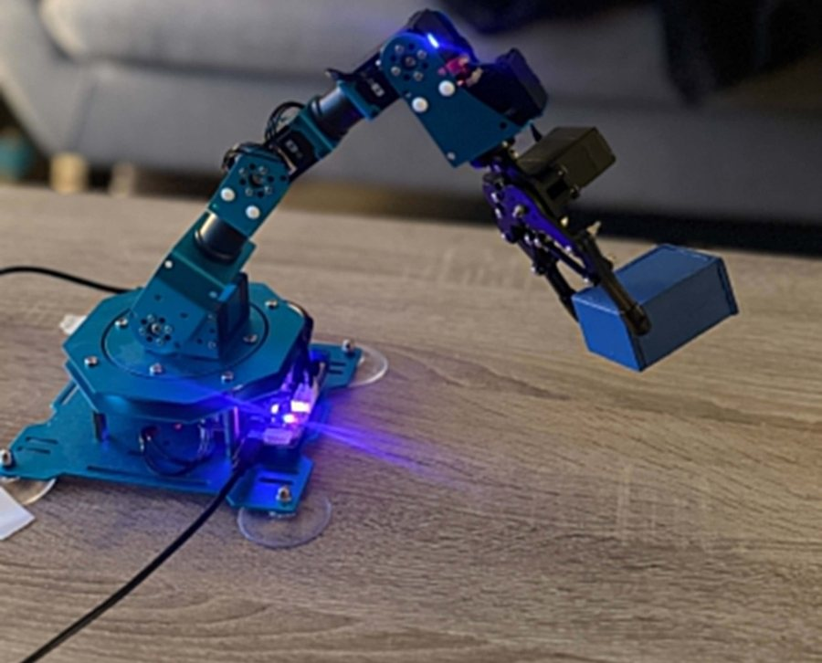</td>
    <td width="50%" valign="top">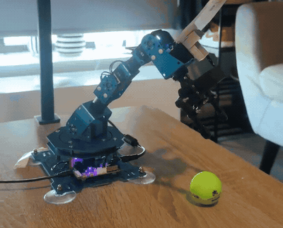</td>
  </tr>
  <tr>
    <td align="center"><sub>A successful lift of the blue box</sub></td>
    <td align="center"><sub>The golf-ball failure mode, slowed down: on target, then squeezed out</sub></td>
  </tr>
</table>

Result tables and the full 60-trial log with operator notes are in [`docs/results/`](docs/results).

## Problems I hit and how I solved them

| Symptom | Diagnosis | Fix |
|---|---|---|
| The arm only grasped reliably in a 4 cm patch of the table | It reaches 28% past its URDF, and a global scale still leaves 14 mm RMS of position-dependent error that six touch points cannot model | Closed-loop visual servo that makes aim independent of the kinematics |
| A colour-based centroid landed about 85 mm from the can's centre | The off-centre label on the can mesh biased the HSV mask | Depth defines geometry, and colour only names the blob |
| ChArUco corners would not decode on the ToF amplitude image | The amplitude image is too soft for fine markers | Detect on RGB, compose through the factory extrinsic, cross-check against a depth plane fit |
| The real gripper closed above objects and grasped air | IK targeted the nominal tip frame at +90 mm, but the fingers actually meet at +59 mm | Moved the tool point to the measured finger-contact point |
| The simulator overstated grasp feasibility | The URDF gripper opened to 72 mm, and the real one measures 55 mm | Corrected the URDF and tolerances, then reran the full 480-trial sweep |
| Simulated objects were flung away, and "grasps" welded onto air | Position-controlled fingers penetrated objects, and the old plugin welded regardless of contact | Effort-controlled fingers and a contact-triggered weld |
| The simulated arm hung limp at startup | On this setup, stock `gazebo_ros2_control` passed the URDF as a CLI parameter that the Humble parser rejected, and DDS discovery was failing over WSL's Hyper-V network | Vendored a working build, forced `ROS_LOCALHOST_ONLY=1`, and wrote a bringup script that waits for active controllers and retries |
| The servo silently fell back to open loop | A floppy paper marker read as a white blob, so it was never detected | A stiff, flat marker. Unmeasured trials are logged as such and excluded from the formal results |

## What's next: teaching it to play chess

> **Status: planned, not built.** Nothing in this section exists in the code yet. The numbers come from
> this repo's IK, calibration and sensor data.

I want this arm to play a full game against a person on a real board. Chess is the natural next
step because it pushes on everything the thesis could keep simple:

- **Dense scenes.** Up to 32 pieces, where the thesis bench handled one object at a time.
- **Tighter tolerances.** 20 mm squares, with neighbours close enough to hit.
- **Built-in ground truth.** Only legal moves can be true, so the rules catch perception errors and
  every move becomes an automatically scored trial.
- **No time pressure.** It is turn-based, so a camera-in-the-loop servo that takes seconds per
  correction is fine.


On paper, a 16 cm board with 20 mm squares fits the reach of this arm: all 64 square centres plan
successfully, and 46 allow an approach of at least 85°. But only 22 are inside the radius where the servo
is reliable today, which is why remounting the marker comes first.

| Stage | Reused from this repo | New work |
|---|---|---|
| Locate the board | ChArUco and `solvePnP` calibration | Map the 64 square centres into the table frame |
| Read the position | Depth for geometry, colour for identity | Per-square occupancy and piece colour. Recover the opponent's move by matching changes against legal moves with [python-chess](https://python-chess.readthedocs.io/) |
| Choose a move | None | [Stockfish](https://stockfishchess.org/) over UCI |
| Plan the motion | `arm_ik.py`, `grasp_common.py` | Square-to-square waypoints, a grip height per piece type, a bin for captures |
| Aim | `visual_servo.py` | Mount the marker low over the jaw gap so the loop covers the whole board |
| Grip | The 60-trial failure analysis | Fingertips that hold round pieces, since the golf-ball result predicts flat jaws will fail, and a partial jaw opening to clear neighbours |
| Verify | Overhead perception | Re-read the board after every move, then retry or ask for help on a mismatch |

**The research question I most want to answer: does depth noise finally matter?** The thesis objects are large
enough that the median ignores their edge pixels, and chess pieces may not be. At this camera height one ToF
pixel covers about 1.45 mm, and a sharp wall reads as a slope 6 to 7 pixels wide. The top of a 14 mm piece spans about
10 pixels, so I estimate roughly 90% of its pixels would sit on that slope, far past the 50% of outliers a
median can tolerate. I expect height estimates to fail first. Rerunning the noise sweep on chess pieces would
show where the thesis result stops holding, and how much of the job RGB has to take over.

Milestones:

- [ ] Add a board and pieces to the Gazebo twin, and test perception there first
- [ ] Register the board and read per-square occupancy, scored against known positions
- [ ] Infer the opponent's move through legal-move filtering
- [ ] Remount the marker and extend servo convergence across the full board
- [ ] New fingertips, then square-to-square moves with measured placement error
- [ ] Stockfish in the loop: a full game, reported as per-move success with confidence intervals

Other directions from the thesis:

- **A better gripper.** Compliant pads or a small cradle for round and near-jaw-width objects.
- **A learned estimator.** Compare the median baseline with a model such as MVGrasp, to see whether a data-driven
  method is more or less sensitive to the same edge noise.
- **Harsh environments.** Characterise the camera outdoors or in dust and heat, to test the predicted crossover directly.
- **Modern Gazebo.** Gazebo Classic is end-of-life. A port to Gazebo Sim with better contact physics would let the
  analytic metric be checked against physical grasps.
- **A richer noise model.** Add spatial correlation and multipath, both left out here.

## Try it

### No ROS or hardware needed

These checks need only Python and NumPy:

```bash
git clone https://github.com/Marci0309/thesis_wsl.git && cd thesis_wsl
pip install numpy

# Validate the closed-form IK against the full forward kinematics
python3 xarm1s_manipulation/test/test_ik.py

# Visual-servo self-test: 500 synthetic scenes with position-dependent bias
python3 xarm1s_manipulation/xarm1s_manipulation/visual_servo.py

# The real-arm pipeline with the arm unplugged: every servo command is printed, not sent
mkdir -p tof_perception/captures_4c
echo '{"scene":"demo","objects":{"coke_can":{"table_xy":[0.37,0.33],"z":0.05}}}' \
    > tof_perception/captures_4c/demo_perceived.json
python3 xarm1s_manipulation/scripts/real_grasp_executor.py \
    --object coke_can --scene demo --servo --dry-run
```

```text
[selftest] 500 random objects | position-dependent bias + 1mm cam noise | K=0.6 cap=4
  closed-loop final err mm: mean 1.85 median 1.89 p95 2.90 max 3.97
  reached <=4mm: 500/500 (100.0%) | mean iters 2.7

coke_can: table[0.37, 0.33] -> arm[-0.059, -0.116], tilt 88.0 deg, grasp_z 0.820, close 46mm
[dry-run] set_gripper 55mm -> S1=388
[dry-run] move_joints 1500ms: S2->0  S3->918  S4->324  S5->462  S6->395
  [servo] 3 meas / 3 steps, err 14.42->2.31 mm, conv
```

On a Windows console, set `PYTHONUTF8=1` first.

<details>
<summary><b>Run the simulation</b> (Ubuntu 22.04 or WSL2, ROS 2 Humble, Gazebo Classic 11)</summary>

The package manifests do not list every runtime dependency, so install them explicitly:

```bash
sudo apt install ros-humble-desktop ros-humble-gazebo-ros-pkgs \
    ros-humble-ros2-control ros-humble-ros2-controllers ros-humble-control-toolbox \
    ros-humble-cv-bridge ros-humble-tf2-geometry-msgs ros-humble-sensor-msgs-py \
    python3-colcon-common-extensions python3-opencv python3-matplotlib python3-yaml
```

The scripts expect the workspace at `~/thesis_ws`, with this repository as its `src` folder. Keep colcon's
default isolated install layout, because the launch file looks for plugins under `install/<package>/lib`.

```bash
mkdir -p ~/thesis_ws
git clone https://github.com/Marci0309/thesis_wsl.git ~/thesis_ws/src
cd ~/thesis_ws
source /opt/ros/humble/setup.bash
colcon build --symlink-install
source install/setup.bash
```

```bash
# Terminal 1: Gazebo, controllers and perception. Wait for "SIM READY".
bash ~/thesis_ws/src/xarm1s_manipulation/scripts/start_sim.sh

# Terminal 2: ground-truth pick-and-place of all four objects
bash ~/thesis_ws/src/xarm1s_manipulation/scripts/run_demo.sh
```

Reproduce the sweeps:

```bash
# Phase 3: pose error against noise, 7 conditions, 60 s each
bash ~/thesis_ws/src/evaluation/scripts/rerun_phase3_sweep.sh 60
python3 ~/thesis_ws/src/evaluation/scripts/summarize_phase3.py

# Phase 4A: grasp feasibility against noise, 6 conditions, 20 placements per object
bash ~/thesis_ws/src/xarm1s_manipulation/scripts/rerun_4a_sweep.sh 20
python3 ~/thesis_ws/src/xarm1s_manipulation/scripts/summarize_4a_rates.py
```

Results land in `evaluation/results/`. [`RUNNING_THE_EXPERIMENT.md`](RUNNING_THE_EXPERIMENT.md) covers manual
runs. It is a working note, so where it disagrees with the code (the object layout, for example), the code is correct.

</details>

<details>
<summary><b>Run the real arm</b> (Hiwonder xArm 1S, OAK-D SR PoE, Windows and WSL2)</summary>

You need the [A1 ChArUco board](tof_perception/board_4b/charuco_A1_7x5_100mm.pdf), a stiff ArUco marker on the
gripper (`DICT_4X4_50`, id 4), and fresh calibration, since the files here are specific to the original bench. The
camera's factory calibration (`oakd_calib.json`, written by
[`dump_oakd_intrinsics.py`](tof_perception/scripts/dump_oakd_intrinsics.py)) is not in the repository.

| Task | Host | Python packages |
|---|---|---|
| Arm control and calibration | Windows, Python 3.11 | `xarm`, `hidapi`, `numpy` |
| Camera capture and live view | Windows, Python 3.14 | `depthai`, `opencv-python`, `numpy` |
| Perception and analysis | WSL2 | `opencv`, `numpy`, `matplotlib` |

The [runbook](xarm1s_manipulation/PHASE4C_RUNBOOK.md) covers calibration and single grasps, and the
[bench recipe](xarm1s_manipulation/PHASE4C_BENCH_RECIPE.md) covers the closed-loop trials. Both are working notes
with paths from the original machine.

</details>

## Repository layout

| Path | Contents |
|---|---|
| [`tof_perception`](tof_perception) | `pose_estimator` node, and real-camera capture, calibration and noise-fitting scripts |
| [`noise_injection`](noise_injection) | `depth_noise_injector` node, with the measured OAK-D and literature Kinect configs |
| [`evaluation`](evaluation) | `pose_evaluator` node, sweep and summary scripts |
| [`xarm1s_manipulation`](xarm1s_manipulation) | `grasp_executor` node, closed-form IK, visual servo, shared grasp data, real-arm bridge |
| [`xarm1s_description`](xarm1s_description) | URDF, meshes, controllers, spawn launch file |
| [`xarm1s_gazebo`](xarm1s_gazebo) | Tabletop world and object models |
| [`xarm1s_grasp_plugin`](xarm1s_grasp_plugin) | Contact-triggered Gazebo grasp plugin in C++ |
| [`_thirdparty/gazebo_ros2_control`](_thirdparty/gazebo_ros2_control) | Vendored v0.4.12 |
| [`docs`](docs) | README media, charts, and result tables |

**Reading the code? Start with** [`visual_servo.py`](xarm1s_manipulation/xarm1s_manipulation/visual_servo.py),
[`arm_ik.py`](xarm1s_manipulation/xarm1s_manipulation/arm_ik.py),
[`depth_noise_injector.py`](noise_injection/noise_injection/depth_noise_injector.py),
[`pose_estimator.py`](tof_perception/tof_perception/pose_estimator.py) and
[`link_attacher.cpp`](xarm1s_grasp_plugin/src/link_attacher.cpp).

## Limitations

- **The simulated rate is not a physical grasp rate.** It checks whether open jaws would straddle the object and
  cannot capture slip, friction or roll, so it compares with the real metric only loosely.
- **"No effect at measured noise" applies to this model and this estimator.** The noise model leaves out spatial
  correlation and multipath, lateral jitter uses a literature value, and the sweep scales only the axial term.
- **Samples are small.** n=4 per object for real pose, n=15 per object for real grasps, and n=20 per simulated cell.
  The simulated intervals are Wald, which collapse at 0% and 100%. The real intervals are Wilson.
- **The task is narrow.** A fixed top-down camera, a flat table, four colour-distinct objects, translation-only pose,
  and a predefined grasp per object. Real grasps ran with one object in view at a time.
- **The servo is reliable only within about 20 cm** of the base with the current marker mount.
- **Gazebo Classic reached end of life** in January 2025, so the simulation needs Humble-era tooling.

## Thesis and citation

*Investigating the Sim-to-Real Gap in RGB-D Based Tabletop Pose Estimation and Manipulation.* Full text available on
request.

```bibtex
@thesis{szokedencsi2026simtoreal,
  author      = {Szokedencsi, Marcell Mor},
  title       = {Investigating the Sim-to-Real Gap in {RGB-D} Based Tabletop Pose
                 Estimation and Manipulation},
  type        = {{BSc} thesis},
  institution = {University of Groningen},
  year        = {2026}
}
```

AI assistants (Claude) helped with debugging, code structure and writing, as disclosed in the thesis. The experimental
design, data collection, analysis and results are my own.

Key references:

- Nguyen, Izadi, Lovell. *Modeling Kinect Sensor Noise for Improved 3D Reconstruction and Tracking.* 3DIMPVT, 2012.
- Foix, Alenyà, Torras. *Lock-in Time-of-Flight (ToF) Cameras: A Survey.* IEEE Sensors Journal, 2011.
- Sarbolandi, Lefloch, Kolb. *Kinect Range Sensing: Structured-Light versus Time-of-Flight Kinect.* CVIU, 2015.
- Garrido-Jurado et al. *Automatic Generation and Detection of Highly Reliable Fiducial Markers Under Occlusion.* Pattern Recognition, 2014.
- Yang et al. *REPLAB: A Reproducible Low-Cost Arm Benchmark for Robotic Learning.* ICRA, 2019.

## License and credits

First-party code is MIT-licensed. The root [`LICENSE`](LICENSE) covers six packages, and `xarm1s_grasp_plugin` has
[its own MIT license](xarm1s_grasp_plugin/LICENSE). Bundled third-party content keeps its own terms, listed in
[`ATTRIBUTION.md`](ATTRIBUTION.md):

- **`gazebo_ros2_control` v0.4.12:** BSD-3-Clause and Apache-2.0, from
  [ros-controls](https://github.com/ros-controls/gazebo_ros2_control).
- **Coke can mesh:** based on
  ["Soda Can 250ml"](https://sketchfab.com/3d-models/soda-can-250ml-557bd388b7b340a88053016f39c3d514) by
  [sebastian204](https://sketchfab.com/sebastian204), licensed under
  [CC BY 4.0](https://creativecommons.org/licenses/by/4.0/). Centred and recoloured.
- **Banana mesh:** based on
  ["Banana"](https://sketchfab.com/3d-models/banana-dda3a1f707a94c52bed79578e120937c) by
  [Lassi Kaukonen](https://sketchfab.com/thesidekick), licensed under
  [CC BY 4.0](https://creativecommons.org/licenses/by/4.0/). Decimated and recoloured.
- **xArm 1S meshes:** adapted from the
  [Hiwonder X-Arm assembly](https://grabcad.com/library/hiwonder-x-arm-1) by Yair Casas on GrabCAD. The MIT license does
  not cover them.

**Get in touch:** [LinkedIn](https://www.linkedin.com/in/marcell-szokedencsi)
